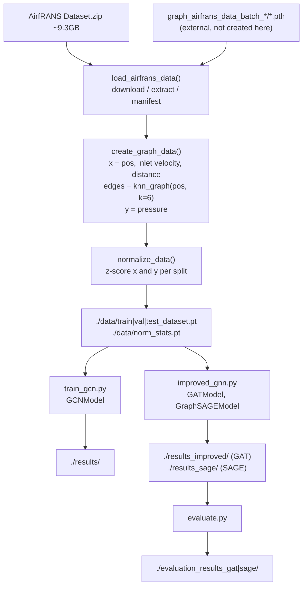
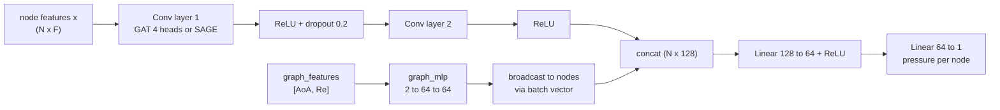
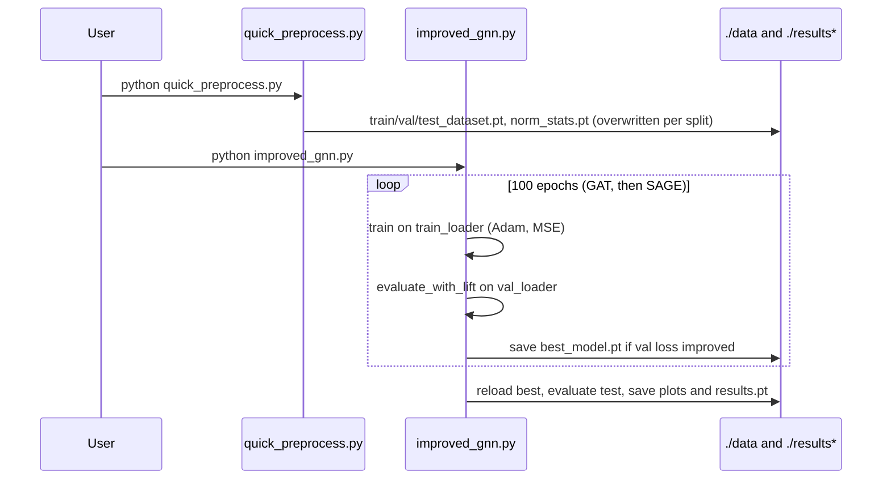

# GNN-for-Airfoil — Interview Deep-Dive

> **Who this is for:** me (the author), preparing to explain and defend this project in ML interviews.
> **How to read it:** each section starts with a plain-English summary. Technical detail comes after it. Jargon is explained the first time it appears, and there's a [Glossary](#glossary) at the end.
> **Ground rules:** everything is checked against the code in this repo (HEAD `562573c`) and, for the dataset API, against the source of the `airfrans` package (v0.1.5.1, `airfrans/dataset.py`). Anything that can't be checked is marked **UNVERIFIED**.

---

## 0. TL;DR

- **What:** a graph neural network (GNN) "surrogate" for computational fluid dynamics (CFD). It aims to predict the pressure field around a 2-D airfoil (a wing cross-section) in milliseconds instead of running a slow simulation. Data: the **AirfRANS** dataset (~9.3 GB of RANS simulations). Models: a 2-layer **GCN** baseline, plus **GAT** and **GraphSAGE** variants that also take angle-of-attack and Reynolds number.
- **State:** research prototype. **No results, logs or trained models are committed.** The README lists *expected* outcomes ("Cp MSE < 1e-3, lift error < 10%, R² > 0.9"), **not achieved ones**.
- **Biggest things to know before an interview:**
  1. **Data loading doesn't match the real `airfrans` API.** `af.dataset.load()` returns a *tuple* `(list_of_arrays, list_of_names)` (airfrans 0.1.5.1 `dataset.py:56-123`). `data_preprocess.py:185-189` treats it as a list of samples with `.pos`/`.pressure` attributes. On a fresh download, the raw-data path will fail with "no valid samples processed". The only path that can work is loading pre-made `.pth` graph files (`graph_airfrans_data_batch_*`), and **this repo doesn't create them**.
  2. **On that `.pth` path, the train/val/test split is ignored** (`data_preprocess.py:49-53`). All three "splits" are the *first N* graphs of the same list, so **val and test are subsets of train**. Any score from that path measures memorisation, not generalisation.
  3. **Shape bug in the loss.** `create_graph_data` makes `y` shape `(N,1)`. The training loop compares it with `out.squeeze()` of shape `(N,)` (`train_gcn.py:37`, `improved_gnn.py:317`). PyTorch's `MSELoss` then **broadcasts to an N×N matrix**: a wrong loss, and out-of-memory on meshes with ~10⁵ nodes.
  4. The target is AirfRANS **kinematic pressure** `p/ρ`, not the pressure *coefficient* Cp. Plots and README call it Cp. "Lift" is computed with a rough approximation that isn't the lift integral.

---

## 1. One-paragraph pitch (30-second answer)

"Wind-tunnel-quality airflow simulations (RANS CFD) take minutes to hours per design, which is too slow for design optimisation loops. I built a graph-neural-network surrogate on the AirfRANS dataset. Each simulation mesh becomes a graph: nodes carry position, inflow velocity and distance-to-airfoil, and edges come from a k-nearest-neighbour graph. The network predicts the pressure at every node. I compared a GCN baseline against GAT and GraphSAGE models that also inject the angle of attack and Reynolds number as graph-level conditioning. I evaluated with MSE, R² and an integrated lift error. The goal is a surrogate that predicts a whole flow field in milliseconds."

*(Be prepared: this pitch describes the design. §8 and §10 explain why there are no trustworthy numbers yet.)*

---

## 2. Plain-language explanation

**The problem.** When air flows over a wing, it speeds up over the top and slows under the bottom. That creates a pressure difference, and the pressure difference is what makes *lift*. Engineers compute this with **CFD** (computational fluid dynamics): they chop the space around the wing into hundreds of thousands of tiny cells (a *mesh*) and solve the physics equations in every cell. It's accurate but slow.

**The idea.** If we've already solved about 1,000 of these cases, maybe a neural network can learn the pattern and *instantly* guess the pressure for a new wing shape or angle. That fast stand-in is called a **surrogate model**.

**Why a graph?** A mesh isn't a neat grid of pixels. Cells are tiny near the wing and huge far away. A **graph** (dots connected by lines) can represent any irregular mesh. Each dot (*node*) is a point in space. Lines (*edges*) connect each point to its neighbours. A **graph neural network** lets each point repeatedly "listen" to its neighbours and update its own guess. That mirrors how pressure at one point depends on the flow around it.

**What this repo does.**
1. Load the AirfRANS simulations.
2. Turn each one into a graph (each point is linked to its 6 nearest points).
3. Train three kinds of GNN to predict pressure at every point.
4. Measure the error.

**The honest caveat.** Some parts of the data loading don't match the dataset library, and when data comes from pre-made files, the "test" airfoils were also in the training set. Fixing that is the first step before believing any result.

---

## 3. Architecture

### 3.1 Components

| File | Role |
|---|---|
| `data_preprocess.py` | Download/extract AirfRANS, convert samples → PyG `Data` graphs (k-NN edges), z-score normalise, save `./data/{split}_dataset.pt` + `norm_stats.pt`, plot first sample |
| `quick_preprocess.py` | Calls `preprocess_dataset` with 100/50/50 samples |
| `check_download_status.py` | Reports whether `Dataset.zip` / `manifest.json` / `./data/*.pt` exist |
| `skip_if_exists.py` | Exit 0 if all four preprocessed files exist |
| `train_gcn.py` | `GCNModel` (2× GCNConv + Linear), training loop, best-on-val checkpoint, test metrics, plots |
| `improved_gnn.py` | `GATModel`, `GraphSAGEModel` (+ graph-level MLP for AoA/Re), lift-coefficient approximation, training both models |
| `evaluate.py` | Reload GAT/SAGE checkpoints, per-sample evaluation, chordwise Cp plots |

### 3.2 Architecture diagram



### 3.3 Model data flow (GAT / GraphSAGE)



### 3.4 Training lifecycle



---

## 4. Tech stack

| Library | Why chosen | Alternatives & trade-offs |
|---|---|---|
| **PyTorch** (`torch>=2.0`) | The standard deep-learning framework | JAX (fast, less GNN tooling) |
| **PyTorch Geometric** (`torch-geometric>=2.3`) | Ready-made `GCNConv`, `GATConv`, `SAGEConv`, `knn_graph`, `Data`/`DataLoader` batching of variable-size graphs | DGL (similar); hand-written sparse message passing (more control, more bugs) |
| **airfrans** | Official loader/downloader for the AirfRANS dataset (NeurIPS 2022 Datasets track) | Downloading the raw OpenFOAM files and parsing them with `pyvista` |
| numpy / scikit-learn | `mean_squared_error`, `r2_score` | `torchmetrics` (GPU-side) |
| matplotlib | Mesh, Cp-field and chordwise plots | pyvista (proper mesh rendering) |
| pandas | Listed in `requirements.txt` but **never imported** | — |

*Why GNNs at all?* AirfRANS meshes are unstructured. CNN surrogates (e.g. U-Net on a re-gridded field) need interpolation onto a grid and lose resolution near the airfoil. GNNs and point-cloud networks work on the native nodes.

---

## 5. Code walkthrough

### 5.1 `data_preprocess.py`

- **`load_airfrans_data` (`:13-189`)** has two paths:
  1. **Pre-made `.pth` path (`:15-70`)**:
     - If `./airfrans_data/graph_airfrans_data_batch_*/*.pth` exist, load them all (`torch.load(..., weights_only=False)` at `:27` so PyG `Data` objects can be unpickled).
     - If they're already graphs, return `all_data[:n_samples]` (`:49-53`).
     - ⚠️ **`split` is never used here**, so train, val and test all get the *same leading slice* of one list.
  2. **Raw AirfRANS path (`:72-189`)**:
     - Downloads `Dataset.zip` (`af.dataset.download`) or reuses a manually placed zip (validated with `z.testzip()`).
     - Extracts it, searches recursively for `manifest.json`, then calls `af.dataset.load(root, task, train=(split=='train'))`.
     - ⚠️ In airfrans 0.1.5.1 this returns `(data_list, name_list)`. `dataset[:n_samples]` slices **the tuple**, not the simulations.
     - ⚠️ It also loads **every simulation in the split into memory first** (the airfrans loader loops over the whole manifest), which defeats "quick" mode. The README warns about the 9.3 GB download but not about this.
     - ⚠️ `split='val'` and `split='test'` both map to `train=False`, so **val and test are the first 20/50/100 simulations of the same official test set**: identical in quick mode, and overlapping otherwise.
  - Interactive `input()` prompts (`:92`) make it unusable in batch jobs (SLURM/CI).
- **`create_graph_data` (`:191-262`)**:
  - Expects an object with `.pos`/`.inlet_velocity`/`.distance_to_airfoil`/`.pressure`/`.angle_of_attack`/`.reynolds_number`, or a dict with those keys.
    - AirfRANS gives neither. It gives a `(N, 12)` numpy array with columns: `[x, y, u_in_x, u_in_y, sdf, n_x, n_y, u, v, p/ρ, ν_t, is_surface]` (airfrans `dataset.py:105-118`).
    - The matching `Simulation` class uses `.position` and `.sdf`, not `.pos`/`.distance_to_airfoil`.
  - Node features: `x = [pos, inlet_velocity, distance]` (`:216-232`). Surface **normals** and the **surface flag** are not used.
  - **Edges:** `knn_graph(pos, k=6, loop=False)` (`:235`). This ignores the real CFD mesh connectivity, and k-NN in raw coordinates can **connect nodes across the thin trailing edge**, i.e. through the solid airfoil.
  - **Target:** `y = pressure` reshaped to `(N,1)` (`:238-243`). If pressure is missing, it **silently becomes zeros** (`:244-246`).
  - **Graph-level features:** `[angle_of_attack, reynolds_number]` as a 1-D tensor of length 2 (`:249-252`). The defaults (`0.0`, `1e6`) are used silently if missing, so every sample can end up with the same "AoA".
- **`normalize_data` (`:264-297`)**: per-feature mean/std of `x`, and a scalar mean/std of `y`.
  - ⚠️ Called **separately for each split** (`preprocess_dataset:383`). Val and test are normalised with *their own* statistics, which (a) leaks test-set information and (b) puts the splits on different scales.
  - ⚠️ `norm_stats.pt` is saved on *every* call (`:394`), so the file left on disk holds the **test split's stats**. Training code later uses it to denormalise *validation* predictions too.
- `visualize_mesh` (`:299-325`) draws every edge with `ax.plot` in a Python loop. With ~10⁵ nodes × 6 edges that's ~10⁶ matplotlib calls, which is very slow.

### 5.2 `train_gcn.py`

- **`GCNModel` (`:11-27`)**: `GCNConv(F→64) → ReLU → dropout(0.2) → GCNConv(64→64) → ReLU → Linear(64→1)`.
- **`train_epoch` (`:29-41`)**: `loss = criterion(out.squeeze(), batch.y)` (`:37`).
  - ⚠️ `out.squeeze()` is `(N,)`, `batch.y` is `(N,1)`, and `nn.MSELoss` broadcasts that to `(N,N)` with only a warning. The loss becomes the mean over all *pairs* of nodes, which is mathematically wrong, and with N ≈ 8 graphs × ~10⁵ nodes the allocation is impossible.
  - The fix: `criterion(out, batch.y)` or `out.view(-1)` vs `batch.y.view(-1)`.
- **`evaluate` (`:43-66`)**: MSE and R² computed with sklearn on **all nodes of all graphs pooled**, in **normalised** units.
- **`train_model` (`:110-178`)**: Adam (lr 1e-3), 100 epochs, batch size 8. It checkpoints the best validation loss to `best_model.pt`, reloads it and evaluates on test.
  - Standard pattern, but since val ⊆ test (raw path) or val ⊆ train (`.pth` path), "best on val" is not a clean model-selection signal.
- `torch.load('./data/*.pt')` (`:183-185`) has no `weights_only=False`. PyTorch ≥ 2.6 defaults to `weights_only=True`, so loading pickled PyG `Data` lists fails on recent PyTorch.
- `from torch_geometric.data import DataLoader` (`:5`) is the deprecated import location. The current one is `torch_geometric.loader.DataLoader`.

### 5.3 `improved_gnn.py`

- **`GATModel` (`:11-55`)**:
  - `GATConv(F→64, heads=4)` gives 256 dims, then `GATConv(256→64, heads=1)`.
  - A 2-layer `graph_mlp` embeds `[AoA, Re]` into 64 dims. The result is broadcast to each node of its graph, concatenated, and passed through `combine` (128→64) + ReLU → `Linear(64→1)`.
- **`GraphSAGEModel` (`:57-100`)**: the same, with `SAGEConv` (mean aggregation by default).
- **Broadcasting loop (`:43-47`, `:88-92`)**: a Python loop over graphs in the batch writes `graph_emb[b]` into masked rows.
  - The vectorised form is `graph_emb[batch]`.
  - ⚠️ **Shape issue:** each graph stores `graph_features` as a 1-D tensor of length 2. PyG's batching concatenates 1-D attributes along dim 0, so a batch of B graphs gives shape `(2B,)`, **not `(B,2)`**. `nn.Linear(2, …)` then fails for B > 1. For B = 1 it "works" but `graph_emb[0]` is a single scalar.
  - Store it as shape `(1,2)` per graph to get `(B,2)` after batching.
  - ⚠️ `Re ≈ 10⁶` goes into the MLP **un-normalised**, while AoA is about 0.1 rad. The MLP's first layer saturates on Re.
- **`compute_lift_coefficient` (`:102-130`)**:
  - Picks "surface" nodes as `|y| < 0.01`. That's a horizontal band around the chord line, which includes **wake and field nodes**, not the airfoil surface (AirfRANS has an explicit surface flag).
  - Then `cl = -trapz(cp, x)` over **mixed upper and lower** points sorted by x.
  - The real formula is $C_L = \oint C_p\,(\mathbf{n}\cdot\hat{\mathbf{e}}_L)\,ds / c$, approximately $\int_0^1 (C_{p,\text{lower}} - C_{p,\text{upper}})\,d(x/c)$ for small AoA.
  - It's also applied to `p/ρ`, not Cp.
- **`evaluate_with_lift` (`:132-205`)**:
  - Splits a batch into graphs with `start_idx = i * (N_total // num_graphs)` (`:176-177`). That assumes **every graph has the same number of nodes**, which is false for AirfRANS meshes. Use `batch.ptr` instead.
  - Denormalises with `norm_stats` (the test stats; see above).
  - Lift error = mean |ΔCl| / mean |Cl| × 100.
- **`train_improved_model` (`:272-376`)** is the same loop as the GCN one, but evaluates lift every epoch. It trains GAT to `./results_improved`, then SAGE to `./results_sage`.

### 5.4 `evaluate.py`

- Rebuilds GAT/SAGE with `hidden_dim=64` and loads the checkpoints. **`evaluate_unseen_airfoils` (`:89-173`)** runs batch size 1 (which sidesteps the per-graph slicing bug), denormalises, computes MSE/R²/MAE and lift error, and plots chordwise "Cp" for the first 5 samples.
- `plot_cp_vs_chordwise` (`:9-60`) separates upper and lower by the sign of y **over all nodes**, not surface nodes, so the "chordwise Cp" plot contains the whole field.
- "Unseen airfoils" is the right *intent*. The AirfRANS test split does contain unseen geometries. But see §5.1 for how the split gets lost.

### 5.5 Utilities
- `check_download_status.py` / `skip_if_exists.py`: friendly status checks so you don't re-download 9.3 GB. They're good developer experience, but they duplicate logic.

---

## 6. Core concepts & theory

### 6.1 RANS CFD and AirfRANS
- **RANS** (Reynolds-Averaged Navier–Stokes) solves the time-averaged flow equations plus a turbulence model (AirfRANS uses Spalart–Allmaras) for steady, incompressible 2-D flow.
- **AirfRANS** (Bonnet et al., NeurIPS 2022 Datasets & Benchmarks):
  - About 1,000 simulations over NACA 4- and 5-digit airfoils.
  - Reynolds 2–6 million, angle of attack −5° to +15°.
  - Each mesh has ~10⁵ nodes.
  - Tasks: `full` (800 train / 200 test), `scarce` (200 train), `reynolds` and `aoa` (extrapolation splits).
- Targets per node: velocity (u, v), kinematic pressure p/ρ, turbulent viscosity ν_t.

### 6.2 Pressure coefficient and lift
- $C_p = \dfrac{p - p_\infty}{\tfrac{1}{2}\rho U_\infty^2}$. It's dimensionless. Values near −1 to −3 on the upper surface mean suction. +1 is the stagnation point.
- With AirfRANS kinematic pressure $\tilde p = p/\rho$: $C_p = (\tilde p - \tilde p_\infty)/(\tfrac12 U_\infty^2)$.
- **Lift coefficient:** integrate the pressure (and shear) force on the surface and project it perpendicular to the inflow:
  $$C_L = \frac{1}{c}\oint_{\text{surface}} \left(-C_p\, \mathbf{n} + \tfrac{2\boldsymbol{\tau}}{\rho U_\infty^2}\right)\cdot \hat{\mathbf{e}}_L \, ds$$
  Thin-airfoil approximation: $C_L \approx \int_0^1 (C_{p,l} - C_{p,u})\, d(x/c)$.

### 6.3 Graph neural networks (message passing)
General form for node *i* with neighbours $\mathcal N(i)$:
$$h_i^{(l+1)} = \phi\Big(h_i^{(l)},\ \square_{j\in\mathcal N(i)}\ \psi(h_i^{(l)}, h_j^{(l)}, e_{ij})\Big)$$
Here □ is a permutation-invariant aggregate (sum, mean or max).

- **GCN** (Kipf & Welling 2017): $H^{(l+1)} = \sigma(\hat D^{-1/2}\hat A\hat D^{-1/2} H^{(l)} W^{(l)})$, with $\hat A = A + I$. It's a degree-normalised neighbourhood average followed by a linear map, i.e. a low-pass filter on the graph.
- **GraphSAGE** (Hamilton et al. 2017): $h_i' = W_1 h_i + W_2\cdot \text{mean}_{j\in\mathcal N(i)} h_j$. The node's own state and its neighbours' are kept in separate linear maps.
- **GAT** (Veličković et al. 2018): learned attention weights per edge:
  $$\alpha_{ij} = \text{softmax}_j\big(\text{LeakyReLU}(a^\top[W h_i \,\|\, W h_j])\big),\quad h_i' = \sigma\Big(\sum_j \alpha_{ij} W h_j\Big)$$
  With multiple heads, outputs are concatenated (layer 1 here: 4 heads × 64 = 256).
- **Receptive field:** 2 message-passing layers on a k=6 graph means each node "sees" only about 2 hops, roughly 40 neighbours. Pressure is a **global, elliptic** quantity: a change at the leading edge affects the whole field. Shallow GNNs are known to under-perform here. Literature models (MeshGraphNets, GraphU-Net, Transolver) use 10–15 layers, multi-scale pooling or attention.
- **Over-smoothing:** stacking many GCN layers makes node features converge. Residual connections and normalisation help.

### 6.4 Conditioning on global parameters
- The **FiLM-like idea** used here: embed the global scalars (AoA, Re) with an MLP and concatenate them to every node.
- AirfRANS already encodes AoA and |U∞| inside the per-node `inlet_velocity` = U∞(cos α, sin α), so the graph-level MLP is partly redundant. If inputs are properly normalised, it can still help.
- Inputs at very different scales (Re ~10⁶ vs α ~0.1) must be normalised. Log-scaling Re is common.

### 6.5 Normalisation and metrics
- **Z-score** $\tilde y = (y-\mu)/\sigma$, fit on **train only** and applied to all splits.
- **MSE** $=\frac1N\sum (y-\hat y)^2$. **R²** $= 1 - \frac{\sum (y-\hat y)^2}{\sum (y-\bar y)^2}$. Pooling every mesh node lets far-field nodes (thousands of near-freestream values) dominate. **Surface** metrics (Cp on the airfoil, C_L, C_D) are what engineers care about. AirfRANS's benchmark reports the Spearman correlation of predicted vs true C_L and C_D.

---

## 7. Data

- **Source:** AirfRANS `Dataset.zip` (~9.3 GB) via `airfrans.dataset.download`, or a manual download. Not committed (`.gitignore` excludes `airfrans_data/`, `data/`, `*.pt`).
- **Schema:**
  - Raw (per simulation): array `(N, 12)` = 7 inputs + 4 targets + surface flag.
  - Graph (after `create_graph_data`): `x (N, 2+2+1=5)`, `edge_index (2, 6N)`, `y (N,1)`, `pos (N,2)`, `graph_features (2,)`.
- **Preprocessing:** k-NN graph (k=6); z-score x and y.
- **Splits as implemented:**

| Path | train | val | test |
|---|---|---|---|
| Raw AirfRANS (if the API mismatch were fixed) | official train[:n] | official **test**[:n_val] | official **test**[:n_test], which **overlaps or equals val** |
| `.pth` files | all[:100] | all[:50], a **subset of train** | all[:50], **identical to val, subset of train** |

- **Leakage:**
  1. Split collapse (above): **critical**.
  2. Per-split normalisation stats, with test stats used for denormalising everything: medium.
  3. Same geometry at several AoA/Re values *within* AirfRANS: the official `full` split handles this. A random split of `.pth` files would not.

---

## 8. Evaluation & results

- **Metrics implemented:** node-level MSE and R² (normalised units), MAE (`evaluate.py`), and a "lift error %" (§5.3, approximate and physically incorrect).
- **Results:** **none committed.** `.gitignore` excludes `results/`, `results_*/`, `*.png` and `*.pt`. The README's "expected outcomes" are **targets, not measurements**. So **no metric can be quoted.**
- **Soundness:** no, as implemented. Split collapse, the loss-broadcast bug, per-split normalisation, the lift approximation, and pooled node metrics mean even a successful run wouldn't measure generalisation to unseen airfoils.
- **What a sound evaluation looks like:**
  - the official AirfRANS `full` test split;
  - train-only normalisation;
  - surface-only Cp MSE;
  - C_L and C_D from proper surface integration (normals and surface flag are in the dataset);
  - Spearman ρ for C_L/C_D;
  - comparison against a simple baseline (e.g. an MLP on node features without message passing) and the published AirfRANS baselines.

---

## 9. Design decisions & trade-offs

| Decision | Gained | Lost |
|---|---|---|
| k-NN graph (k=6) on positions | Works on any point cloud; no mesh file parsing | Ignores true mesh connectivity; can connect across the airfoil; a fixed k ignores the strong density gradient near the wall |
| Shallow 2-layer GNNs | Fast, low memory on 10⁵-node graphs | Tiny receptive field for a global (elliptic) pressure field |
| Graph-level MLP for AoA/Re | Explicit conditioning | Redundant with inlet velocity; un-normalised Re |
| Predict only pressure | Simpler single-output head | AirfRANS benchmarks predict u, v, p, ν_t jointly (multi-task helps physics consistency) |
| Z-score per split | Easy | Leakage + inconsistent scales |
| Many helper scripts for download state | Friendly for a 9.3 GB dataset | Interactive prompts block automation; duplicated logic |

---

## 10. Honest weaknesses

1. **The raw AirfRANS path cannot work as written.** `af.dataset.load` returns `(data_list, name_list)`. `dataset[:n]` slices the tuple, and `create_graph_data` expects attributes or dict keys that numpy arrays don't have (`data_preprocess.py:185-189`, `:196-210`). Every sample errors out, giving `ValueError("no valid samples processed")` (`:379-380`).
2. **The `.pth` path ignores `split`** (`:49-53`): test ⊂ train. Any reported score would be training performance.
3. **Val and test are the same simulations** on the raw path (both `train=False`, both the first n).
4. **MSE broadcast bug** (`train_gcn.py:37,54`; `improved_gnn.py:162,317`): `(N,)` vs `(N,1)` gives an `(N,N)` loss.
5. **Batched `graph_features` shape** `(2B,)` breaks `graph_mlp` for batch size > 1 (`improved_gnn.py:40,85`).
6. **`norm_stats.pt` overwritten by the last split processed** (`data_preprocess.py:394`), and per-split normalisation.
7. **Lift computation is not lift.** It uses a band |y| < 0.01 instead of surface nodes, mixes upper and lower surfaces, and works on p/ρ rather than Cp (`improved_gnn.py:102-130`).
8. **Per-graph slicing assumes equal node counts** (`improved_gnn.py:176-177`).
9. **Target mislabelled as Cp** everywhere in plots and the README.
10. **No results, no tests, no seeds** (`torch.manual_seed` never called), **no CLI args, interactive `input()` prompts**.
11. **Dependency drift:** deprecated `torch_geometric.data.DataLoader`, `torch.load` without `weights_only=False` (breaks on PyTorch ≥ 2.6), and `np.trapz` (deprecated in NumPy 2.0 in favour of `np.trapezoid`).
12. **README provenance:** the quick-start clones `anaya-rs/GNN-Airfoil-Project`, a different repo, which suggests this is a copy of a team project. Be clear in interviews about what you personally built.

---

## 11. How I'd improve it (prioritised)

| # | Change | Effort | Impact |
|---|---|---|---|
| 1 | **Rewrite loading against the real API:** `data_list, names = af.dataset.load(root, 'full', train=True)`; slice `data_list`; build graphs from array columns `[0:2]` pos, `[2:4]` inlet velocity, `[4]` sdf, `[5:7]` normals, `[9]` p/ρ, `[11]` surface | 0.5 day | Pipeline runs at all |
| 2 | **Honest splits:** official `full` train/test; carve val from *train* by geometry name; train-only normalisation saved once | 0.5 day | Metrics mean "unseen airfoil" |
| 3 | Fix loss shape (`out.view(-1)` vs `y.view(-1)`), `graph_features` shape `(1,2)`, use `graph_emb[batch]` and `batch.ptr` | 1 hour | Correct gradients, batching works |
| 4 | **Physics-correct metrics:** Cp from p/ρ; surface-only Cp error; C_L/C_D by integrating `-Cp·n` (plus wall shear if available) over flagged surface nodes; Spearman ρ | 1 day | Comparable to the AirfRANS benchmark |
| 5 | Use the real mesh edges (or radius graph + surface-aware edges) plus relative-position edge features (Δx, Δy, ‖Δ‖) | 1 day | Better inductive bias; no edges through the airfoil |
| 6 | Deeper encoder-processor-decoder (MeshGraphNets-style, ~10 layers with residuals and LayerNorm) or multi-scale (Graph U-Net); predict u, v, p, ν_t jointly | 2–3 days | Large accuracy gain on a global field |
| 7 | Subsample nodes during training (AirfRANS papers sample ~32k points per mesh), mixed precision | 0.5 day | Fits larger batches; faster |
| 8 | Reproducibility: seeds, argparse/config, remove `input()`, pin versions, save results JSON + plots, commit a results table | 0.5 day | Credible, automatable |
| 9 | Baselines: MLP on node features (no edges), plus a comparison against published AirfRANS numbers | 0.5 day | Shows the GNN adds value |

---

## 12. How to run it

```bash
python -m venv venv && source venv/bin/activate
pip install -r requirements.txt          # torch, torch-geometric, airfrans, sklearn, matplotlib, numpy, pandas
python check_download_status.py           # where is the data?
python quick_preprocess.py                # 100/50/50 graphs -> ./data/  (interactive prompts possible)
python train_gcn.py                       # -> ./results/
python improved_gnn.py                    # GAT -> ./results_improved/, SAGE -> ./results_sage/
python evaluate.py                        # -> ./evaluation_results_gat|sage/
```

- **Data:** place `Dataset.zip` (~9.3 GB) in `./airfrans_data/` to skip the download.
- **Expected outcome today:** with the official dataset, preprocessing will likely stop with "no valid samples processed" (§10.1). With external `.pth` graphs it runs, but see the split warning.
- **Env vars:** none.

---

## 13. Resume bullets (truthful)

- Built a **graph-neural-network CFD surrogate** pipeline in PyTorch Geometric for the **AirfRANS** RANS dataset: unstructured meshes → k-NN graphs, node-wise pressure regression, and **GCN, GAT and GraphSAGE** variants with graph-level conditioning on angle of attack and Reynolds number.
- Implemented data tooling for a **9.3 GB** scientific dataset (resumable download detection, zip validation, manifest discovery) and evaluation utilities for field error, R² and an integrated-lift metric.
- *(After fixing §10.1–4)* Audited the pipeline and fixed split leakage, normalisation and loss-shape bugs so results reflect generalisation to unseen airfoil geometries.

> ⚠️ Don't quote "R² > 0.9" or "lift error < 10%". Those are README *targets*, never measured in this repo.

---

## Glossary

- **CFD**: computational fluid dynamics, numerically solving fluid equations.
- **RANS**: Reynolds-averaged Navier–Stokes, steady CFD with a turbulence model.
- **Surrogate model**: a fast learned approximation of an expensive simulator.
- **Airfoil / chord / angle of attack (AoA)**: wing cross-section; its length; the angle between the chord and the incoming flow.
- **Reynolds number (Re)**: ratio of inertial to viscous forces, $Re = U c/\nu$.
- **Cp / C_L**: pressure coefficient; lift coefficient.
- **Graph / node / edge**: points and the connections between them.
- **k-NN graph**: connect each point to its k closest points.
- **GCN / GAT / GraphSAGE**: three message-passing GNN layer types (normalised averaging / attention-weighted / separate self-and-neighbour maps).
- **Message passing**: each node updates its state from its neighbours' states.
- **Receptive field**: how far (in hops) information can travel through the network.
- **Z-score normalisation**: subtract the mean, divide by the std.
- **R²**: fraction of target variance explained by predictions.
- **PyG**: PyTorch Geometric.
